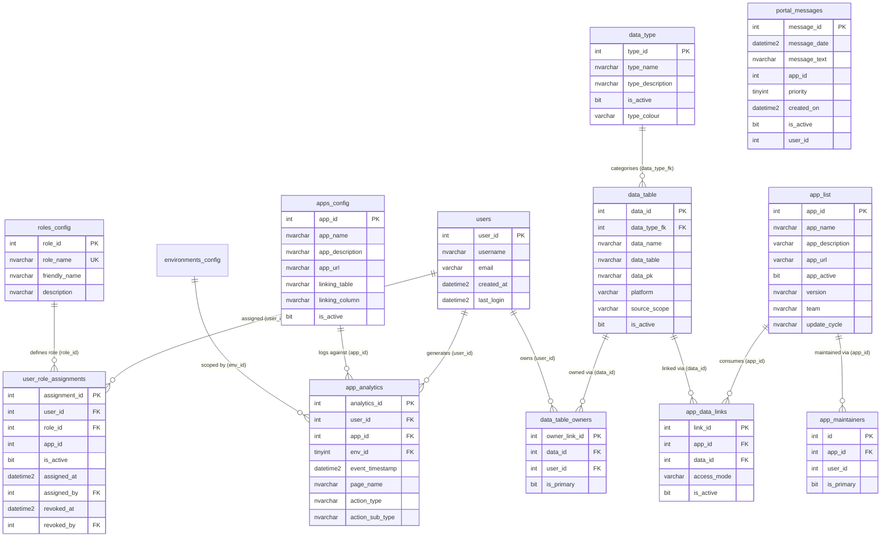

# Shared Portal Platform Schema (`dauPortalTools`)

**Database:** `Data_Insight_Team` (SQL Server)  
**Schema:** `[01_SSSR]`  

This schema provides the shared identity, role-based access control (RBAC), telemetry, portal messaging, and data catalogue metadata used across all DAU/SSSR Shiny applications via [`dauPortalTools`](https://github.com/DFE-Digital/dauPortalTools).

---

## 1. Entity Relationship Diagram

## 2. Identity & Role-Based Access Control (RBAC)

### 2.1 `[01_SSSR].[users]`
Canonical user directory provisioned automatically on first login via `dauPortalTools::utils_record_login()`.

| Column | Type | Null | Default / Constraint | Description |
| :--- | :--- | :--- | :--- | :--- |
| **`user_id`** | `int` | No | `PK`, `IDENTITY(1,1)` | Canonical integer user ID referenced across all audit columns (`created_by`, `updated_by`) and domain foreign keys (`delivery_officer_id`, `wn_follow_user_id`). |
| `username` | `nvarchar(100)` | Yes | — | Extracted username / Windows or Posit Connect login handle. |
| `email` | `varchar(255)` | Yes | — | User's DfE email address. |
| `created_at` | `datetime2(7)` | No | `sysutcdatetime()` | First login timestamp. |
| `last_login` | `datetime2(0)` | Yes | — | Most recent session start timestamp. |

### 2.2 `[01_SSSR].[roles_config]`
Master lookup of available application roles across the DAU portal suite.

| Column | Type | Null | Default / Constraint | Description |
| :--- | :--- | :--- | :--- | :--- |
| **`role_id`** | `int` | No | `PK`, `IDENTITY(1,1)` | Unique role identifier. |
| `role_name` | `nvarchar(50)` | No | `UQ` | System role key checked in R code (e.g., `admin`, `editor`, `viewer`). |
| `friendly_name` | `nvarchar(100)` | No | — | Human-readable label shown in UI badges and admin panels. |
| `description` | `nvarchar(255)` | Yes | — | Scope and permissions granted by the role. |

### 2.3 `[01_SSSR].[user_role_assignments]`
Maps users to roles scoped to a specific `app_id`, supporting soft revocation with full audit history.

| Column | Type | Null | Default / Constraint | Description |
| :--- | :--- | :--- | :--- | :--- |
| **`assignment_id`** | `int` | No | `PK`, `IDENTITY(1,1)` | Unique assignment record ID. |
| `user_id` | `int` | No | `FK → users`, `UQ` (with role, app) | Target user's canonical ID. |
| `role_id` | `int` | No | `FK → roles_config`, `UQ` | Assigned role ID. |
| `app_id` | `int` | No | `UQ` | Target application ID (`config.yml` → `app_details$app_id`). |
| `is_active` | `bit` | No | `1` | `1` = active assignment; `0` = revoked. |
| `assigned_at` | `datetime2(7)` | No | `sysutcdatetime()` | Grant timestamp. |
| `assigned_by` | `int` | No | `FK → users` | User ID of granting admin. |
| `revoked_at` | `datetime2(7)` | Yes | — | Revocation timestamp (if `is_active = 0`). |
| `revoked_by` | `int` | Yes | `FK → users` | User ID of revoking admin. |

---

## 3. Application Configuration, Telemetry & Banners

### 3.1 `[01_SSSR].[apps_config]` & `[01_SSSR].[environments_config]`
* **`apps_config`**: Registers each portal (`app_id`, `app_name`, `app_url`, `linking_table`, `linking_column`, `is_active`) used by `dauPortalTools` for telemetry, role scoping, and cross-app navigation.
* **`environments_config`**: Lookup table defining deployment tiers (`env_id`: e.g., Dev, Test, Prod) referenced by `app_analytics`.

### 3.2 `[01_SSSR].[app_analytics]`
Centralised usage telemetry table populated automatically by `dauPortalTools` page/action trackers.

| Column | Type | Null | Default / Constraint | Description |
| :--- | :--- | :--- | :--- | :--- |
| **`analytics_id`** | `int` | No | `PK`, `IDENTITY(1,1)` | Unique event ID. |
| `user_id` | `int` | No | `FK → users` | Active user's canonical ID. |
| `app_id` | `int` | No | `FK → apps_config` | Source application ID. |
| `env_id` | `tinyint` | No | `FK → environments_config` | Environment tier ID. |
| `event_timestamp` | `datetime2(7)` | No | `sysutcdatetime()` | UTC timestamp of event. |
| `page_name` | `nvarchar(150)` | No | — | Active `page-*` or `panel-*` route name. |
| `action_type` | `nvarchar(50)` | No | — | Event category (e.g., `page_view`, `filter`, `update`, `export`). |
| `action_sub_type` | `nvarchar(255)` | Yes | — | Optional granular event metadata. |

### 3.3 `[01_SSSR].[portal_messages]`
Stores global and app-specific service banners rendered at the top of DAU portals.

| Column | Type | Null | Default / Constraint | Description |
| :--- | :--- | :--- | :--- | :--- |
| **`message_id`** | `int` | No | `PK`, `IDENTITY(1,1)` | Unique banner message ID. |
| `message_date` | `datetime2(0)` | No | `sysutcdatetime()` | Display/effective date of message. |
| `message_text` | `nvarchar(4000)` | Yes | — | Banner body text. |
| `app_id` | `int` | No | — | Target `app_id` (or global scope ID). |
| `priority` | `tinyint` | No | `2` | Severity/styling tier (`1` = high/alert, `2` = standard info). |
| `created_on` | `datetime2(0)` | No | `sysutcdatetime()` | Creation timestamp. |
| `is_active` | `bit` | No | `1` | `1` = visible in portal; `0` = soft-deleted. |
| `user_id` | `int` | Yes | — | Author's canonical user ID. |

---

## 4. Portal & Data Catalogue Metadata (`app_list`, `data_table`, etc.)

Used by the SLIC Hub (`dau-sssr-finally`) and `page-about.R` / `page-user.R` across portals to surface live app metadata, maintainers, and lineage:

* **`[01_SSSR].[app_list]` & `[01_SSSR].[app_maintainers]`**: Tracks registered portals (`version`, `team`, `update_cycle`, `reviewed_date`, `app_guidance`) and their primary/secondary technical maintainers (`is_primary`). *(Note: `FK_app_maintainers_app_id` currently points to `[01_AIDT].[app_list]`—align to `[01_SSSR].[app_list]` if migrating legacy constraints).*
* **`[01_SSSR].[data_type]`**: Categorises data assets (`type_name`, `type_colour` defaulting to `#1d70b8`).
* **`[01_SSSR].[data_table]` & `[01_SSSR].[data_table_owners]`**: Registers underlying SQL/Databricks tables (`platform`, `source_scope`: `DAU`/`Internal`/`External`, `data_pk`) and assigns data owners (`user_id`, `is_primary`).
* **`[01_SSSR].[app_data_links]`**: Many-to-many bridge recording which apps consume which `data_table` assets and under what `access_mode` (`READ`, `WRITE`, `READ_WRITE`).